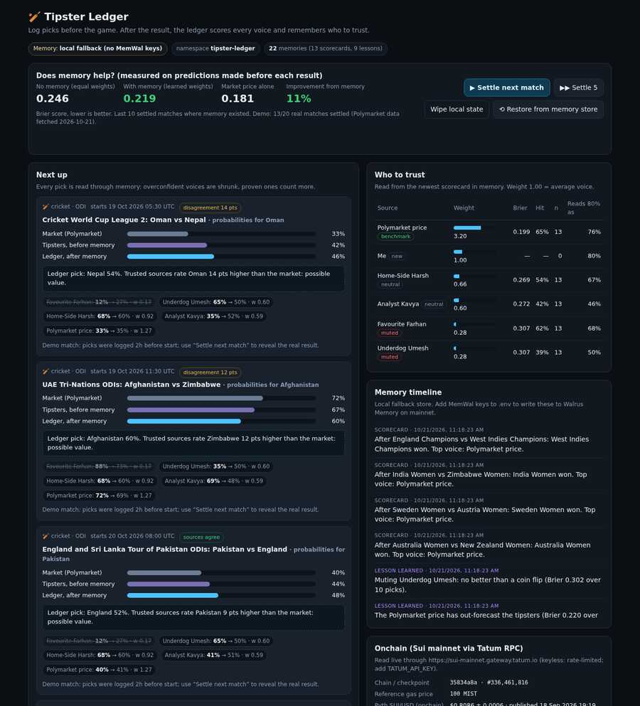

# 🏏 Tipster Ledger

**A cricket and markets pick journal that learns who to trust.**
You log picks from tipsters, analysts and yourself *before* a match. When the result is in, the ledger scores every voice (Brier score, hit rate, calibration, broken down by competition) and writes a **credibility memory to Walrus Memory on Sui mainnet**. The next recommendation is built from those memories, so the product visibly changes as it learns.

Built for **Walrus x Tatum: Total Recall**, *Markets & Sports Prediction* track. Also entered for *Best Walrus Memory*.



---

## Why

Every cricket fan follows a dozen "experts" on X, Telegram and YouTube. Nobody keeps score. The loudest voice wins, not the most accurate one. Bookmaker odds and prediction markets often disagree with the tipsters too, and nobody tells you which side has been right before.

Tipster Ledger keeps the receipts:

- **Picks are locked at the start time.** A pick logged after the start is never scored.
- **Every voice is scored the same way:** Brier score (a proper scoring rule), hit rate, and over/under-confidence, overall and per competition (T20, ODI, Women's T20 and so on).
- **The ledger remembers.** After each result it writes a scorecard plus any new lesson ("Muting Underdog Umesh", "Favourite Farhan's 88% now counts as 77%", "Home-Side Harsh is an ODI specialist") to Walrus Memory.
- **Memory changes the product.** The next match's consensus is read through those memories: overconfident voices are shrunk, proven ones count more, consistently wrong ones get muted or even faded (inverted).
- **It flags disagreement.** Market price (Polymarket), bookmaker odds (de-vigged) and tipsters are compared, and big gaps are called out.

## What "memory visibly changes the product" means here

| Before memory | After memory |
|---|---|
| Every tipster counts the same (weight 1.00) | Weights range from about 0.2 to 4+, learned from results |
| A source's "88%" is taken at face value | It is re-read through their calibration ("88% → 77%") |
| No recommendation ("Still learning…") | "Ledger pick: Afghanistan 63%. In line with the market." |
| Muted/faded voices count fully | Muted voices are struck through in the UI and barely count |
| Wipe the browser/server and it's gone | **Restore from Walrus** rebuilds the whole ledger from mainnet memories |

The hero panel measures this honestly: it compares the Brier score of what the app showed **before** each result, with memory and without. On the bundled real data, over the last 10 settled matches the memory-weighted ledger scores **0.172 vs 0.194** for equal weights (about **11% better**). Across all 19 matches where memory existed, the two are level (0.227 vs 0.227): early memory is thin and noisy, and that's what a learning curve looks like. The market price on its own is still the best single forecaster on this sample (0.157 over the last 10), and the ledger works that out: the market ends up as its highest-weighted voice. (Run the replay and check the numbers; `tests/ledger.test.ts` asserts the last-10 improvement.)

## Architecture

```mermaid
flowchart LR
  subgraph UI["Next.js app (src/app, src/components)"]
    A[Log pick before start] --> B[Settle result]
    H[Next up: consensus before vs after memory]
  end
  subgraph Engine["Learning loop (src/lib, pure TS + vitest)"]
    S[scoring/metrics + credibility<br/>Brier · calibration · shrinkage · segments]
    L[engine/ledger<br/>settle → scorecard + lessons<br/>weightsFromMemory → consensus]
    O[odds/disagreement<br/>de-vig · gaps · recommendation]
  end
  subgraph Memory["memory/ (adapter interface)"]
    MW[MemWalMemoryStore<br/>@mysten-incubation/memwal]
    LC[LocalMemoryStore<br/>dev/tests fallback]
  end
  subgraph Chain["Sui mainnet"]
    R[Walrus Memory relayer<br/>embed · Seal encrypt · Walrus upload]
    W[(Walrus blobs<br/>owned by MemWal account)]
    P[(Pyth SUI/USD<br/>PriceInfoObject)]
    AC[(MemWalAccount<br/>delegate keys)]
  end
  T[Tatum Sui RPC gateway<br/>sui-mainnet.gateway.tatum.io]
  PM[Polymarket public APIs<br/>prices + results]

  B --> L --> S
  L -->|scorecard + lessons| MW --> R --> W
  MW -->|recall sort=recent| L --> H
  O --> H
  PM --> H
  T -->|sui_getObject| P
  T -->|sui_getObject| AC
  T -->|suix_getOwnedObjects + dynamic fields| W
  T --> UI
```

**Where each sponsor technology does real work**

- **Walrus Memory (MemWal), mainnet** (`src/lib/memory/memwal.ts`): `rememberAndWait` / `rememberBulkAndWait` write each settlement's scorecard and lessons (with idempotency keys, plus retry and backoff for relayer rate limits). `recall({ sort: "recent" })` loads the newest scorecard, and that is where the product reads its weights from. Each scorecard also carries the event, every pick and what the app showed, so `restoreFromMemory()` can **rebuild the entire ledger from Walrus alone**.
- **Tatum Sui RPC** (`src/lib/tatum/*`, typed JSON-RPC client using the `x-api-key` header):
  - **Proves the memories are onchain without trusting the relayer.** It reads the `MemWalAccount` (owner, plus delegate keys = agent ids), lists the Walrus `Blob` objects the owner holds, and decodes each blob's metadata dynamic field (`memwal_namespace`, `memwal_agent_id`). The UI's *Verify memories onchain* button and `npm run verify:onchain` count our namespace's memories.
  - **Settles "markets" picks from an onchain oracle.** It reads the Pyth SUI/USD `PriceInfoObject` and decodes the price, confidence and publish time. A question like "SUI/USD ≥ $1.00 at lock time?" is settled only if the onchain price was published *after* the lock (Pyth on Sui is a pull oracle, so staleness is shown, never hidden).
  - Network status: chain id, latest checkpoint, reference gas price.
- **Polymarket public APIs** (`src/lib/polymarket/gamma.ts`, `scripts/fetch-seed.ts`): live cricket match prices, and for the demo seed, real resolved matches with the last traded price before the start.

## Run it

```bash
npm install
npm run dev          # http://localhost:3000
npm test             # vitest: 42 tests
npm run build        # production build
```

It runs with **no keys at all**: memory falls back to a local JSON store, and Tatum is called keyless (heavily rate-limited). To write to Walrus Memory on mainnet and use a Tatum key, copy `.env.example` to `.env` and follow [SETUP.md](SETUP.md).

## Demo: do X, see Y

1. **Open the app.** *Next up* shows real cricket matches (from Polymarket, October 2026) with picks from four tipster personas, logged 2h before each start. The memory badge reads `0 memories`. Weights are all 1.00 and the box says *Still learning*.
2. **Click ▶ Settle next match.** The real result is revealed and every pick is scored. A **scorecard memory** is written (on mainnet if MemWal is configured; the timeline shows its Walrus blob id). *Who to trust* now has weights.
3. **Click ▶▶ Settle 5.** Lessons start appearing in the *Memory timeline*, for example *"Muting Favourite Farhan: no better than a coin flip"* and *"Favourite Farhan is overconfident: their typical 88% now counts as 77%"*. In *Next up*, the chips now show `88% → 76% · w 0.68`, muted voices are struck through, and **Tipsters, before memory** and **Ledger, after memory** diverge.
4. **Keep settling.** The hero panel's *Improvement from memory* turns positive on the later matches. Disagreement flags (`disagreement 13 pts`) appear where market and tipsters split.
5. **Click Wipe local state.** Everything local is gone and the weights reset to 1.00.
6. **Click ⟲ Restore from Walrus.** The app recalls its memories from Walrus Memory and rebuilds every settled match, pick and weight. **The app picks up where it left off.** That is portable memory.
7. **Onchain panel → Verify memories onchain.** Through Tatum's Sui RPC this reads the MemWal account and counts the Walrus blob objects in the `tipster-ledger` namespace (the hackathon needs ≥ 10).
8. **Add live events → Load upcoming cricket.** Import a real upcoming match (optionally paste a bookmaker's decimal odds, e.g. `1.80 2.05`), then log your own pick and a tipster's. Or **Add markets question** for SUI/USD, settled from Pyth via Tatum.

> Headless alternative: `npm run memwal:replay` settles all 20 seed matches and writes 34 memories (20 scorecards + 14 lessons) to mainnet, paced for the relayer's limits.

## Code map

```
src/lib/scoring/metrics.ts        Brier, log loss, hit rate, calibration buckets
src/lib/scoring/credibility.ts    shrinkage-weighted trust, calibration factor, segments, statuses
src/lib/odds/disagreement.ts      decimal odds, de-vig, disagreement levels, recommendation
src/lib/engine/ledger.ts          settle → scorecard + lessons; weightsFromMemory; consensus; memoryLift; rebuildFromMemories
src/lib/engine/seed.ts            real matches + rule-based personas (never see results)
src/lib/engine/service.ts         persistence (.data/), memory writes/recall, dashboard view model
src/lib/memory/                   MemoryStore interface · MemWal implementation · local fallback · text codec
src/lib/tatum/                    Sui JSON-RPC client · Pyth decoder · MemWal account/blob verification
src/lib/polymarket/gamma.ts       live cricket markets
src/app/api/*                     thin route handlers
scripts/                          fetch-seed · memwal-smoke · replay-to-memory · verify-onchain
tests/                            vitest (fixtures captured from Sui mainnet via Tatum)
```

## Honest notes

- **Seed tipsters are synthetic.** Each one is a fixed rule applied to the real pre-match price (e.g. "always back the favourite at 88%"). They never see results, so the scores they earn come from real outcomes. Match results and prices are real public Polymarket data (`data/seed/matches.json`; regenerate with `npm run seed:fetch`).
- **Pyth on Sui is a pull oracle.** The SUI/USD object only updates when someone pushes a price, so markets questions can wait for an update. The app says so instead of guessing.
- The managed Walrus Memory relayer is free during the launch period, with usage limits (per-key and per-account rate limits, 1 GB per account).
- Local state lives in `.data/` (git-ignored). On serverless hosts, set `TIPSTER_DATA_DIR=/tmp/tipster`; with MemWal configured, *Restore from Walrus* rebuilds the state after a cold start.
- Not betting advice.

## License

MIT
